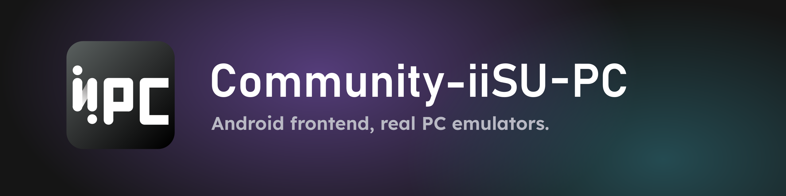
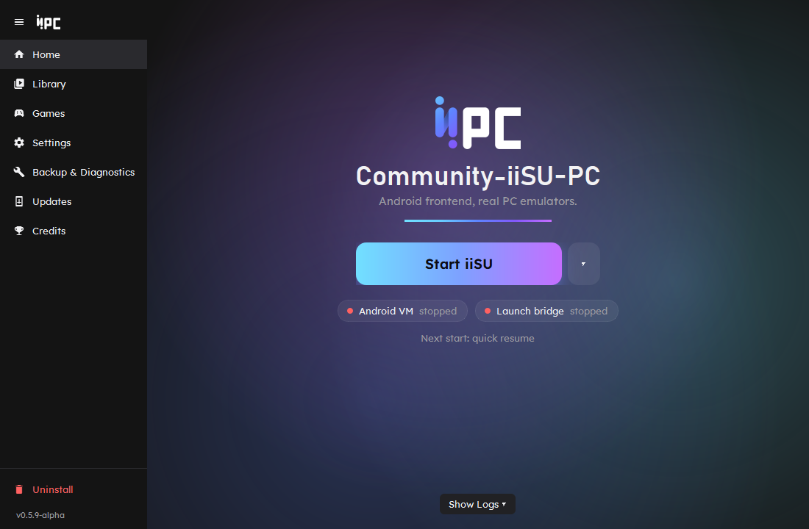
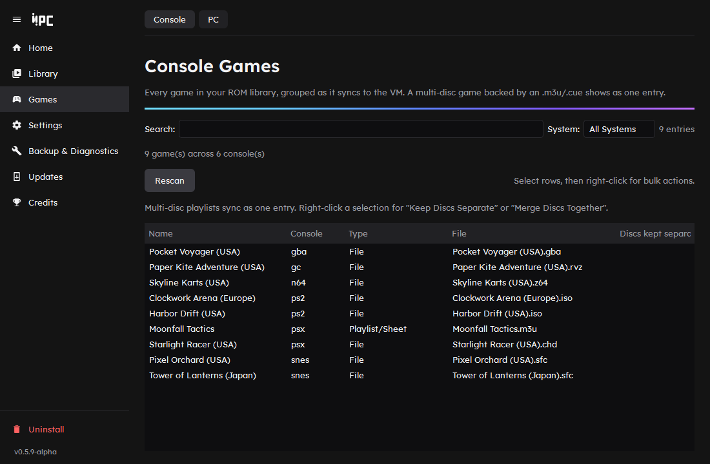
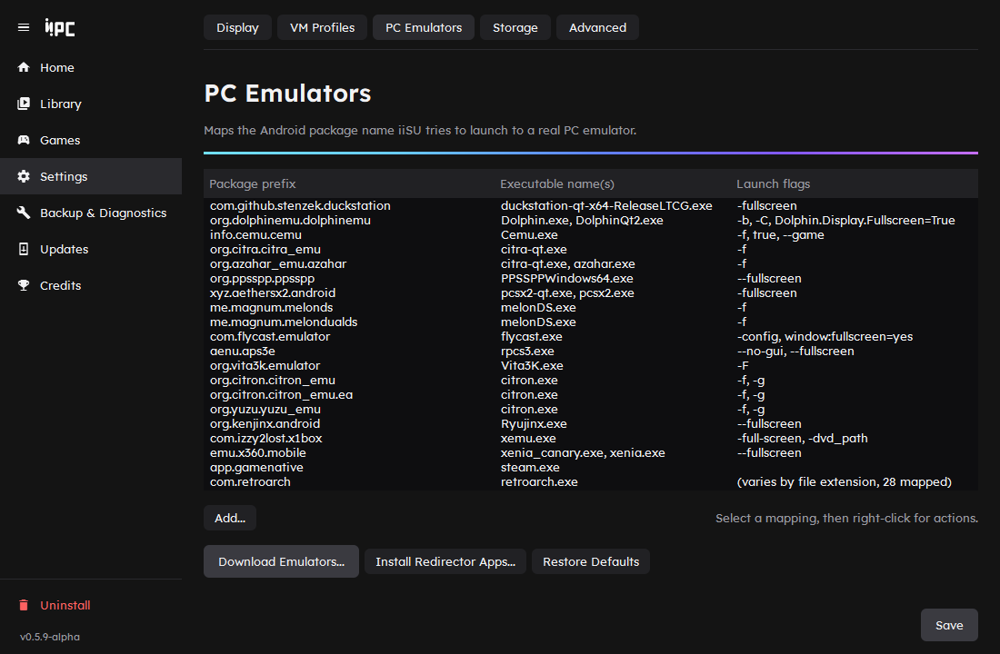

<div align="center">



**The iiSU frontend on your PC, launching real PC emulators.**

[](https://github.com/MAGOOSKEE/Community-iiSU-PC/releases)
[](https://github.com/MAGOOSKEE/Community-iiSU-PC/actions/workflows/tests.yml)

[](LICENSE)

[Download](https://github.com/MAGOOSKEE/Community-iiSU-PC/releases/latest) ·
[Install guide](docs/installing.md) ·
[User guide](docs/using.md) ·
[Linux](docs/linux.md) ·
[Troubleshooting](docs/troubleshooting.md) ·
[Contributing](CONTRIBUTING.md)



</div>

## What it is

[iiSU](https://github.com/iisu-network/iiSU) is an Android emulation frontend. Community-iiSU-PC runs it inside a hardware-accelerated Android VM on Windows or Linux and patches it so that picking a game hands off to a real PC emulator (DuckStation, Dolphin, PCSX2 and so on) instead of an Android one. You get iiSU's interface with PC performance.

> [!IMPORTANT]
> **iiSU is not included.** iiSU is closed-source, third-party software, and this project has no affiliation with it. You supply your own copy of its APK, and Setup patches that copy on your PC. Nothing from iiSU is bundled or redistributed.

## Features

- **One-click setup.** Setup downloads a self-contained Android VM, patches and installs your iiSU APK, and creates a desktop shortcut.
- **Your ROMs, your emulators.** Your ROM library is mirrored into the VM as tiny placeholders, and each console maps to a PC emulator you choose.
- **PC games too.** Add any program or `steam://` link, or import your Steam library, and launch it from iiSU.
- **Controller friendly.** Navigate with a controller, quit a game with Select+Start or Escape, and add the whole thing to Steam or a Steam Deck.
- **A Manager for everything else.** Display, VM profiles, storage, backups, diagnostics, updates and uninstall, in one window.

| Your library | Emulator mappings |
|---|---|
|  |  |

## Quick start

**Windows**

1. Download `Community-iiSU-PC-Setup-<version>.exe` from the [latest release](https://github.com/MAGOOSKEE/Community-iiSU-PC/releases/latest) and run it. Python and Java are bundled.
2. Open **Community-iiSU-PC Manager**, click **Run Setup**, and point it at your iiSU APK.
3. Follow the short wizard (ROM folder, emulators, display, hotkeys), then click **Start iiSU**.

**Linux, or from source**

```bash
git clone https://github.com/MAGOOSKEE/Community-iiSU-PC.git
cd Community-iiSU-PC
./Community-iiSU-PC\ Manager.sh
```

This needs Python 3.11+ and a JDK on your PATH. See the [install guide](docs/installing.md) for the details and the [Linux notes](docs/linux.md) for KDE, Waydroid and Steam Deck.

## Requirements

- Windows 10/11 (64-bit), or a 64-bit Linux distribution (KDE Plasma recommended)
- Your own copy of the iiSU APK
- CPU virtualization turned on (Hyper-V or the Windows Hypervisor Platform on Windows, KVM on Linux)
- About 15 GB of free disk space while Setup runs, and about 9 GB afterwards
- The PC emulators you want to use, installed by you or with the Manager's built-in downloader

The full list, with a disk space breakdown, is in the [install guide](docs/installing.md#requirements).

## Supported emulators

Out of the box, consoles are mapped to DuckStation, PCSX2, RPCS3, PPSSPP, Vita3K, Dolphin, Cemu, Azahar/Citra, melonDS, Citron, Ryujinx, xemu, Xenia, Flycast and RetroArch, plus Steam for PC games. Every mapping can be changed in **Settings > PC Emulators**, and a single game can use a different emulator through its [per-game settings](docs/using.md#per-game-settings).

## Documentation

| Guide | What's in it |
|---|---|
| [Installing](docs/installing.md) | Requirements, disk space, first-time setup, uninstalling |
| [Using it](docs/using.md) | The Manager's pages, hotkeys, VM profiles, Steam, PC games, multi-disc games, per-game settings |
| [Linux](docs/linux.md) | KDE Plasma, Waydroid on Wayland, Steam Deck, how emulators are found |
| [Troubleshooting](docs/troubleshooting.md) | Diagnostics, logs, repairing settings, VM storage |
| [Development](docs/development.md) | How it works, project layout, tests, building the installer |

## Getting help

Run **Backup & Diagnostics > Diagnostics** in the Manager first: it checks the install without changing anything. If that doesn't settle it, [open an issue](https://github.com/MAGOOSKEE/Community-iiSU-PC/issues/new/choose) and attach the logs the form asks for. This is alpha software, so reports are welcome.

## Credits

- **[MAGOOSKEE](https://github.com/MAGOOSKEE)**: project owner, built and maintains Community-iiSU-PC.
- **[jacksterson](https://github.com/jacksterson)**: contributed the original Linux port (KWin/xdotool window management, joydev controller support, cross-platform SDK/shortcut/process handling, the Flatpak emulator downloader).
- **[44kitcaliber](https://github.com/44kitcaliber)**: found and fixed the stuck loading screen and the launch bridge quitting while the VM boots, and made the ROM sync time-limited so it can't hang a start.
- **[Claude](https://github.com/claude)** (Anthropic): AI coding assistant; wrote and refactored most of this codebase in collaboration with MAGOOSKEE.

**AI disclosure:** a large share of this project's code was written by Claude, an AI assistant, working under MAGOOSKEE's direction and review. If you're evaluating this project for safety or correctness before running it, keep that in mind and read the source.

## License

[PolyForm Noncommercial 1.0.0](LICENSE): free to use, fork, modify, and redistribute for any noncommercial purpose. Not licensed for commercial use, including selling it, bundling it into a paid product, or soliciting donations/payment tied to a distribution of it.
