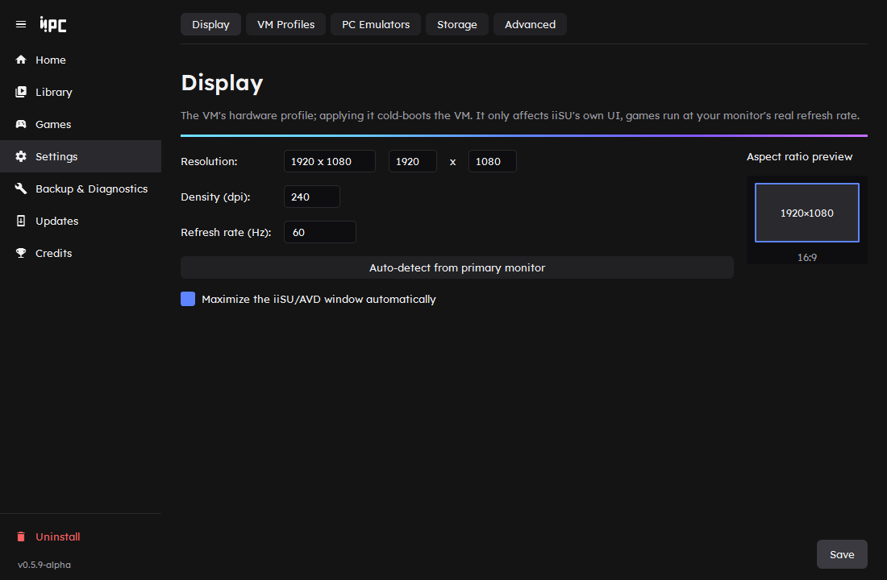
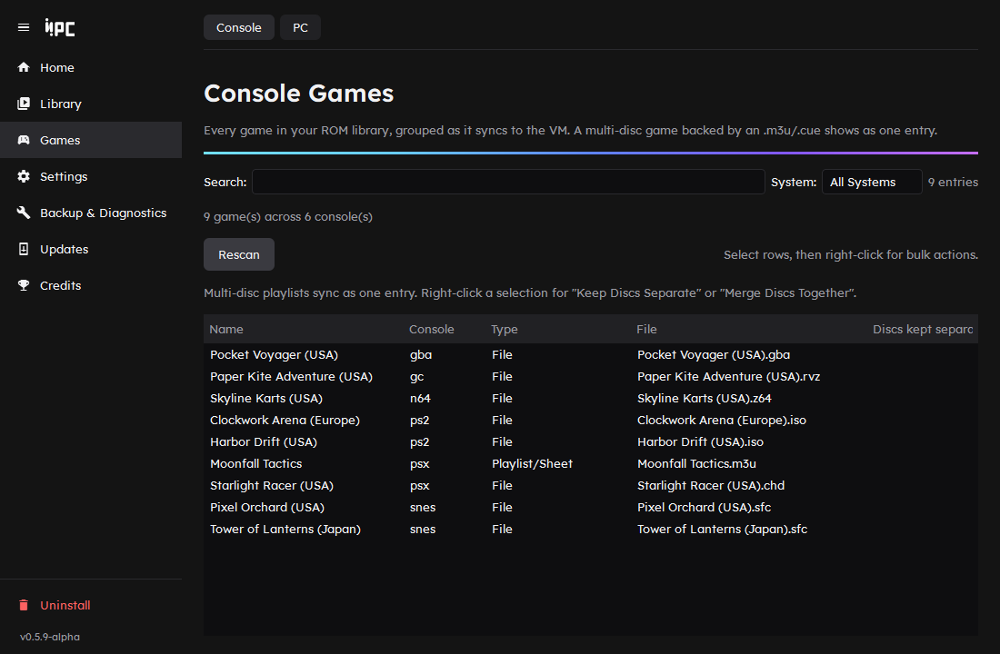

# Using Community-iiSU-PC

[Back to the README](../README.md) · Previous: [Installing](installing.md) · Next: [Troubleshooting](troubleshooting.md)

- [Starting and stopping](#starting-and-stopping)
- [The Manager](#the-manager)
- [Quitting a game: Escape and Select+Start](#quitting-a-game-escape-and-selectstart)
- [The loading screen](#the-loading-screen)
- [Updates](#updates)
- [Console games and multi-disc playlists](#console-games-and-multi-disc-playlists)
- [Per-game settings](#per-game-settings)
- [PC apps and games](#pc-apps-and-games)
- [VM profiles](#vm-profiles)
- [Steam and Steam Deck](#steam-and-steam-deck)

## Starting and stopping

Double-click the **desktop shortcut** to start iiSU directly, or open the Manager and click **Start iiSU** on its Home page. **Stop** on the same page shuts the Android VM and the launch bridge down.

On every start, your ROM library is re-synced into the VM automatically. iiSU still needs to notice new games: hit "Rescan full library" in its Library settings.

Community-iiSU-PC uses a quick resume when nothing relevant has changed since the last start. It only cold-boots (a bit slower) on the very first start, or when something that changes the VM itself has changed: display, VM profile, USB passthrough, the AVD, or switching between a normal and a headless start. Adding ROMs or changing PC emulator mappings doesn't need a cold boot. The Home page tells you which one the next start will be.

## The Manager

One window, navigated with the sidebar.

| Page | What it's for |
|---|---|
| **Home** | Android VM and bridge status, Start/Stop, a running status line and a log drawer. |
| **Library** | **ROM Directory** (your host ROM folder), **Media Library** (check/restore saved media), **Android Storage** (browse and manage the VM's shared storage over ADB). |
| **Games** | **Console** (every detected ROM, grouped by multi-disc playlist) and **PC** (native apps and URI launches). |
| **Settings** | **Display** (the VM's resolution and DPI), **VM Profiles**, **PC Emulators** (which PC emulator each console launches, downloading emulators, reinstalling iiSU's redirector apps), **Storage**, and **Advanced**. |
| **Backup & Diagnostics** | **Backup & Restore** and **Diagnostics**. |
| **Updates** | Community-iiSU-PC and iiSU updates. |
| **Credits** | Who built this and how. |
| **Uninstall** | Below a divider at the bottom of the sidebar. |

### Home

The ▾ next to Start has shortcuts to your ROMs and logs folders, **Recreate Shortcut** and **Clear Resume State**.

- **Recreate Shortcut**, like the end of onboarding, asks whether the desktop shortcut that starts iiSU shows iiSU's own icon (taken from your iiSU APK) or Community-iiSU-PC's iiPC icon. The Manager has its own icon either way. Onboarding's also lets you go without a desktop shortcut.
- **Boot Headless (no window)** boots the VM without its window or the launch bridge. A headless boot always cold boots, ignores and clears the saved resume state, and on Windows uses the host GPU with audio off, because a windowless emulator that renders in software crashes shortly after Android boots. Its Ready means Android has finished booting: the start waits on the VM for the boot animation to end, then watches the emulator for 10 more seconds, and if it dies it says so with the exit code and retries. It isn't available with Waydroid, which has no window to leave out: the menu item is greyed out and a headless start request just starts normally.

### Settings > Advanced

AVD name, bridge port, hotkeys, the volume Android is set to when iiSU starts, **Add to Steam**, and debugging options such as "Show console windows".

A new Android VM starts at about half volume, so by default each start sets it to 100%. Pick another level, or untick the box to leave the volume wherever it was last set inside the VM.

### Backup & Restore

Back up configuration to a ZIP or restore an earlier one, plus a separate backup of the artwork and media files iiSU keeps inside the running VM. iiSU's private in-app data, such as favorites and play history, can't be backed up.

## Quitting a game: Escape and Select+Start

By default, **Escape** controls game quitting and shutdown:

| Where you are | Tap Escape | Hold Escape (1.5 s) |
|---|---|---|
| In an emulated game | Quits the emulator and returns to iiSU | |
| In iiSU | Shuts Community-iiSU-PC down | |
| In a Windows or Steam game | Left to the game (usually its pause or menu key) | Asks the game to close as its window's X would, and only ends it by force if it is still running five seconds later |

The key only acts while iiSU, or the game or emulator it started, is the window in front, so pressing Escape in a browser or anything else never quits your game or shuts the VM down.

Pressing **Select+Start** together on a controller does the same thing on either platform, and the chord is remappable to any combination of buttons. Escape itself is rebindable in **Settings > Advanced** on both platforms.

On Linux, Alt+F4, Ctrl+Q, and Ctrl+Alt+X also force a full shutdown, and Ctrl+Shift+Esc mirrors an Escape tap. These four aren't currently rebindable.

## The loading screen

A fullscreen overlay covers the VM boot and the emulator hand-off, showing what's happening ("Booting Community-iiSU-PC...", "Waiting on DuckStation...") instead of raw desktop. It's off while the debug console checkbox is on.

While Community-iiSU-PC starts, it shows a progress bar with a percentage and the step it is on (the Android VM, your ROM library, iiSU and the launch bridge). The percentage is an estimate from how long each step took on your PC the last few times, kept separately for a quick resume and a full boot, so the very first start uses typical times and it gets more accurate after that. Tick **Show details (the start log) on the loading screen** in Settings > Advanced to also see the log of what it is doing underneath the bar. Waiting on a game to open has nothing to measure, so that screen keeps its moving bar.

The loading screen can always be hidden with Escape or a click, and closes by itself if whatever opened it stops.

## Updates

Automatic project updates are opt-in and can be enabled from the Updates page. **Check for Updates Now** only checks whether an update is available and does not download or install it. When an update is available, the page also shows what's in it.

The same page checks whether a newer iiSU is available (against its official GitHub releases) and can re-patch and reinstall it, with a manual override to point at any APK directly, which is useful for an official pre-release build shared before it's on the releases page.

**Check an APK...** inspects any iiSU APK first (about a minute, installs nothing) and reports which of the patch's hooks it found, so you know before updating whether a new pre-release is supported. The same report is available from a terminal with `python installer/patch_check.py <apk>`.

## Console games and multi-disc playlists

**Games > Console** lists every game detected in your ROM library, grouped the same way syncing to the VM does: a multi-disc game backed by an `.m3u`/`.cue` shows up as one entry, not one per disc. Select rows and right-click for two exceptions to that default:

- **Keep Discs Separate** is for a game like Gran Turismo 2, where an `.m3u` actually bundles distinct, separately-launchable modes rather than continuation discs: the individual files show up in iiSU as their own entries instead, and the playlist/sheet itself is hidden from iiSU (still listed on this page, greyed as "hidden", so you can merge it back together later). Only applies to selected playlists/sheets, never to a plain single-file game.
- **Merge Discs Together** undoes that for a previously-excepted playlist/sheet.

Both take effect on your next Start, not while Community-iiSU-PC is already running.

## Per-game settings

Right-click a single game and choose **Game Settings...** to change how just that game launches:

- use a different PC emulator than the console default
- add extra command-line flags
- set environment variables
- run a program (a display-mode switcher, a helper script) and wait for it before the game starts

Games with settings are marked "(custom settings)" in the list. They're stored in `bridge/config.json` under `game_overrides`, keyed by the ROM's file name, and apply on that game's next launch with no restart. A pre-launch program that fails or runs longer than 30 seconds is logged and the game launches anyway. RetroArch can't be picked as the override emulator because it needs a core chosen per file type.

## PC apps and games

**Games > PC** lets iiSU launch native applications in addition to emulated console games: an executable (`.exe` on Windows) or a registered URI/protocol such as `steam://rungameid/...` on either platform.

Use **Add** for individual programs, or **Import Steam Library** to pick installed Steam games and create URI-based entries automatically (Steam's Linux install locations, including Flatpak, are detected too). The page also includes import/export and a health check for missing executables, placeholders, and other library inconsistencies.

Executable paths are specific to the PC they were configured on, while URI-based entries are generally more portable.

How it's stored

Each entry is represented in iiSU by an empty `.pcgame` placeholder under `bridge/windows_stubs/` (the name is historical, from before Linux support), kept out of your actual ROM directory so it never shows up when you're browsing your real ROM library. The real launch information stays in `bridge/windows_apps.json`; the launch bridge intercepts iiSU's request for the placeholder and starts the configured target instead. Syncing into the VM merges these placeholders into iiSU's `windows` folder automatically. `windows_apps.json` is local runtime configuration and is intentionally ignored by Git.

## VM profiles

**Settings > VM Profiles** holds named launch configurations for the Android SDK emulator: GPU rendering (`auto`, `host`, `swiftshader_indirect`, `angle_indirect`), hardware acceleration, CPU cores, RAM, audio (speakers only, the default; microphone and speakers; or no audio), extra emulator flags, and environment variables.

Pick a profile, Save, Stop, then Start to test it; a profile change cold-boots the VM once. Presets cover the usual suspects, and Duplicate lets you A/B one change at a time.

To chase down audio problems: duplicate your profile, try "Speakers only", then "No audio at all" to confirm audio is the cause, then try other GPU modes.

Every profile also sets `QEMU_AUDIO_TIMER_PERIOD=1000`, which stops the emulator's sound from crackling on Windows; a profile's own environment variables can override it. Profiles only change launch options on the AVD that Setup created, not which Android system image it runs. They don't apply on Waydroid.

## Steam and Steam Deck

**Settings > Advanced > Add to Steam** adds Community-iiSU-PC to Steam as a non-Steam game (on Windows and Linux, native or Flatpak Steam), so you can start it from Steam's library, Big Picture, or a Steam Deck's Game Mode.

Close Steam first: it rewrites its shortcut list when it exits and would undo the change, so the button refuses while Steam is running. The previous list is kept as a `.bak` next to it, and **Remove from Steam** undoes it. The shortcut starts the VM and bridge and then ends, so Steam shows it as stopped while iiSU keeps running.

Steam Deck specifics are on the [Linux page](linux.md#steam-deck).
