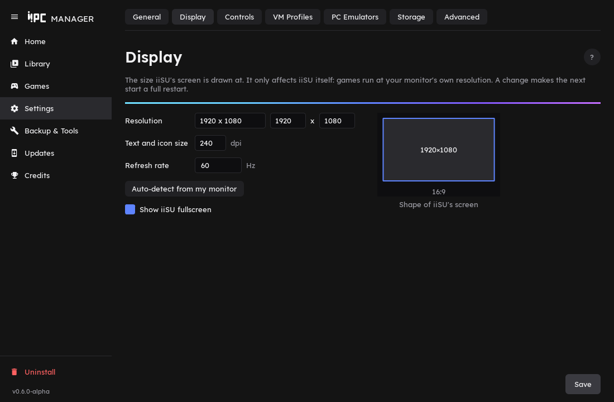
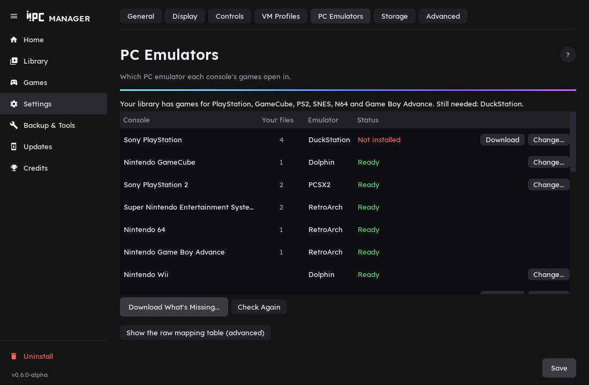
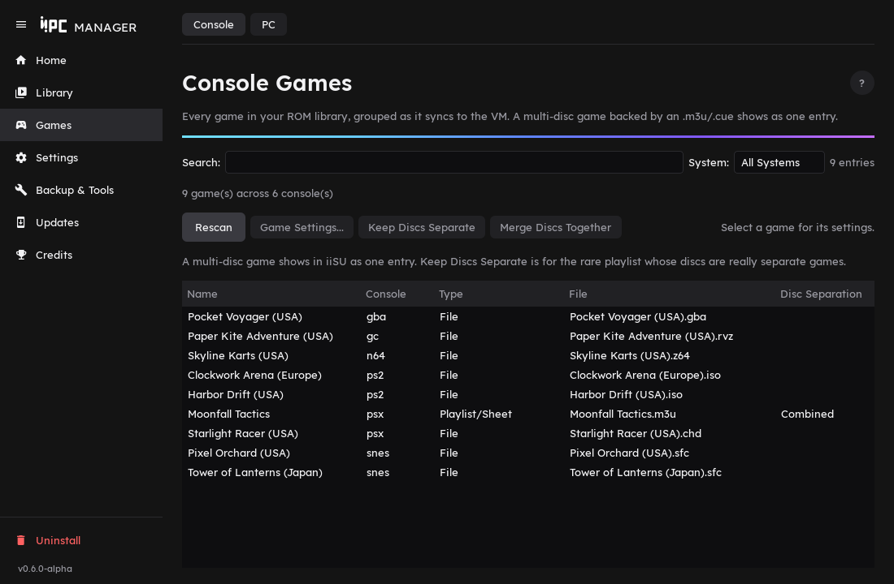

# Using Community-iiSU-PC

[Back to the README](../README.md) · Previous: [Installing](installing.md) · Next: [Troubleshooting](troubleshooting.md)

Every page in the Manager has a **?** next to its title that opens its section of this guide.

- [Starting and stopping](#starting-and-stopping)
- [When a game doesn't open](#when-a-game-doesnt-open)
- [The Manager](#the-manager)
- [Your ROM folder](#your-rom-folder)
- [PC emulators](#pc-emulators)
- [Quitting a game: Escape and Select+Start](#quitting-a-game-escape-and-selectstart)
- [The loading screen](#the-loading-screen)
- [Settings](#settings)
- [Display](#display)
- [Updates](#updates)
- [Console games and multi-disc playlists](#console-games-and-multi-disc-playlists)
- [Per-game settings](#per-game-settings)
- [PC apps and games](#pc-apps-and-games)
- [VM profiles](#vm-profiles)
- [Steam and Steam Deck](#steam-and-steam-deck)

## Starting and stopping

Double-click the **desktop shortcut** to start iiSU directly, or open the Manager and click **Start iiSU** on its Home page. **Stop** on the same page shuts Android and the launch bridge down.

On every start, your ROM library is copied into Android as tiny placeholder files. When that finds games added or removed, iiSU is asked to rescan its library by itself once it's open, so new games show up without visiting iiSU's settings. **Sync Library Now**, in the ▾ menu next to Stop, does the same while iiSU is already running. The automatic rescan can be turned off in **Settings > General**.

Most starts are quick: Android resumes where it left off. It does a full restart (a bit slower) on the very first start, or when something about Android itself changed: display, VM profile, USB passthrough, or switching between a normal and a background start. Adding ROMs or changing PC emulators doesn't need one. Hover over the ▾ next to Start to see which the next start will be.

## When a game doesn't open

If a game can't open (its emulator isn't installed, the ROM has moved, a PC game's program is missing), a card covers the screen for a few seconds saying what went wrong and where to fix it. The Manager's Home page keeps the message, with when it happened, until you dismiss it, and **Backup & Tools > Diagnostics** lists it too. The technical details are in `bridge/launch_history.log`.

## The Manager

One window, navigated with the sidebar.

| Page | What it's for |
|---|---|
| **Home** | Start and Stop, Android and launch bridge status, the last game that failed to open, and the ▾ menu. |
| **Library** | **ROM Directory** (your ROM folder and where emulators are looked for), **Media Library** (check and restore saved artwork), **Android Storage** (browse and move files in Android). |
| **Games** | **Console** (every game in your ROM folder) and **PC** (programs and Steam games). |
| **Settings** | **General**, **Display**, **Controls**, **VM Profiles**, **PC Emulators**, **Storage** and **Advanced**. |
| **Backup & Tools** | **Backup & Restore** and **Diagnostics**. |
| **Updates** | Community-iiSU-PC and iiSU updates. |
| **Credits** | Who built this and how. |
| **Uninstall** | Below a divider at the bottom of the sidebar. |

Lists have their actions as buttons beside them (they grey out until you select something they apply to), and in a right-click menu too.

### Home

The ▾ next to Start has **Start in the Background**, **Sync Library Now**, shortcuts to your ROMs and logs folders, **Recreate Shortcut**, **Add to Steam** and **Remove from Steam**, a **Show Logs** tick box and **Make Next Start a Full Restart**.

- **Show Logs** shows what Start and Stop are doing at the bottom of the Home page. It stays the way you left it.
- **Recreate Shortcut** asks whether the desktop shortcut shows iiSU's own icon (taken from your iiSU APK) or Community-iiSU-PC's iiPC icon.
- **Start in the Background (no window)** starts Android without its window or the launch bridge, for running it unattended. It always does a full restart, and on Windows uses the graphics card with sound off, because a windowless emulator that draws in software crashes shortly after Android starts. It isn't available with Waydroid, which has no window to leave out.
- **Make Next Start a Full Restart** is for when iiSU seems stuck after a quick start.

### Backup & Restore

Back up your settings to a ZIP or restore an earlier one, plus a separate backup of the artwork and media iiSU keeps inside Android. iiSU's private in-app data, such as favorites and play history, can't be backed up.

## Your ROM folder

**Library > ROM Directory** is the folder that holds one subfolder per console (`psx`, `snes`, `gc` and so on). Under it, it says which folders iiSU will recognize, and for one it won't, what to rename it to ("SNES Roms" to `snes`). The onboarding wizard offers to rename them for you. The list below is where PC emulators are looked for: add the folder you install emulators into.

## PC emulators

**Settings > PC Emulators** lists every console with the emulator its games open in, how many of your files it has, and whether that emulator is installed. The consoles in your ROM folder come first, and the line above the list says which emulators they still need.

- **Download** on a row, or **Download What's Missing...**, installs emulators with winget (Windows) or Flatpak (Linux). Emulators the downloader doesn't offer (Citron, Ryujinx, Vita3K, Xenia) you install yourself, then press **Check Again**.
- **Change...** picks another emulator for a console, from the known ones or any program on your PC. Its launch options are filled in for you.
- Consoles that run through RetroArch pick a core per file type, so they can't be changed here; change a single game in [Per-game settings](#per-game-settings).

**Show the raw mapping table** is for the rare change the list can't make: it shows what `config.json` stores, the Android package iiSU asks for, the PC program it opens and the options it's started with. It also has **Reinstall iiSU's Emulator Placeholders...**: iiSU only offers a console once it sees an emulator app for it in Android, so Setup installs a tiny placeholder app for each, and this puts them back if they went missing.

## Quitting a game: Escape and Select+Start

By default, **Escape** controls game quitting and shutdown:

| Where you are | Tap Escape | Hold Escape (1.5 s) |
|---|---|---|
| In an emulated game | Quits the emulator and returns to iiSU | |
| In iiSU | Shuts Community-iiSU-PC down | |
| In a Windows or Steam game | Left to the game (usually its pause or menu key) | Asks the game to close as its window's X would, and only ends it by force if it is still running five seconds later |

The key only acts while iiSU, or the game or emulator it started, is the window in front, so pressing Escape in a browser or anything else never quits your game or shuts Android down.

Pressing **Select+Start** together on a controller does the same thing. Both, and an optional key that shuts everything down from anywhere, are set in **Settings > Controls**.

On Windows, a DualSense or DualShock 4 plugged in without Steam Input (or another tool) translating it can't drive iiSU's menus. When that happens a small notice says so and where to turn it on in Steam (**Settings > Controller**). Tick **Don't show this again** on the notice and it never appears again.

On Linux, Alt+F4, Ctrl+Q, and Ctrl+Alt+X also force a full shutdown, and Ctrl+Shift+Esc mirrors an Escape tap. These four aren't currently rebindable.

## The loading screen

A loading screen covers Android starting and the hand-off to a game ("Waiting on DuckStation..."), instead of showing your desktop. It's off while the debugging consoles are on.

While Community-iiSU-PC starts, it shows a progress bar with a percentage and the step it is on. The percentage is an estimate from how long each step took on your PC the last few times, kept separately for a quick start and a full restart, so it gets more accurate after the first few starts. Tick **Show details (the start log) on the loading screen** in **Settings > General** to see what it's doing underneath.

The loading screen can always be hidden with Escape or a click, and closes by itself if whatever opened it stops.

## Settings

Settings can only be saved while iiSU is stopped; the save bar has a **Stop iiSU** button for that. Changes apply the next time iiSU starts.

| Page | What's on it |
|---|---|
| **General** | Rescanning iiSU's library by itself, Android's volume each time iiSU starts (a new Android VM starts at about half volume), and the loading screen. |
| **Display** | See [Display](#display). |
| **Controls** | The quit key, an optional key that shuts everything down, and the controller buttons that quit a game. |
| **VM Profiles** | See [VM profiles](#vm-profiles). |
| **PC Emulators** | See [PC emulators](#pc-emulators). |
| **Storage** | How Android's internal storage is used, and changing its size: see [Troubleshooting](troubleshooting.md#seeing-and-changing-the-vms-storage). |
| **Advanced** | Rarely needed: how iiSU's window is recognized, the launch bridge's port, the Android VM's name, and the debugging consoles. |

## Display

**Settings > Display** sets the size iiSU's screen is drawn at, its text and icon size, and whether iiSU is shown fullscreen. It only affects iiSU itself: games run at your monitor's own resolution. **Auto-detect from primary monitor** fills it in from your screen. A change makes the next start a full restart.

## Updates

Automatic project updates are opt-in and can be enabled from the Updates page. **Check for Updates Now** only checks whether an update is available and does not download or install it. When an update is available, the page also shows what's in it.

The same page checks whether a newer iiSU is available (against its official GitHub releases) and can re-patch and reinstall it, with a manual override to point at any APK directly, which is useful for an official pre-release build shared before it's on the releases page.

**Check an APK...** inspects any iiSU APK first (about a minute, installs nothing) and reports which of the patch's hooks it found, so you know before updating whether a new pre-release is supported. The same report is available from a terminal with `python installer/patch_check.py <apk>`.

## Console games and multi-disc playlists

**Games > Console** lists every game in your ROM folder, grouped the same way syncing does: a multi-disc game backed by an `.m3u`/`.cue` shows up as one entry, not one per disc. Select a game for its buttons:

- **Game Settings...** (or double-click): see [Per-game settings](#per-game-settings).
- **Keep Discs Separate** is for a game like Gran Turismo 2, where an `.m3u` actually bundles separately playable modes rather than continuation discs: each file shows in iiSU as its own entry, and the playlist itself is hidden from iiSU (still listed here, greyed as "hidden", so you can merge it back later).
- **Merge Discs Together** undoes that.

Both take effect on your next Start.

## Per-game settings

Select a game and choose **Game Settings...** to change how just that game launches:

- use a different PC emulator than the console default
- add extra command-line flags
- set environment variables
- run a program (a display-mode switcher, a helper script) and wait for it before the game starts

Games with settings are marked "(custom settings)" in the list. They're stored in `bridge/config.json` under `game_overrides`, keyed by the ROM's file name, and apply on that game's next launch with no restart. A pre-launch program that fails or runs longer than 30 seconds is logged and the game launches anyway. RetroArch can't be picked as the override emulator because it needs a core chosen per file type.

## PC apps and games

**Games > PC** lets iiSU launch programs on your PC as well as console games: an executable (`.exe` on Windows) or a link such as `steam://rungameid/...` on either platform.

Use **Add Application...** for individual programs, or **Choose Games...** and **Auto-import New** in the Steam card to add installed Steam games (Steam's Linux install locations, including Flatpak, are found too). Select a game for **Test**, **Edit...** and **Remove**; **More...** has import, export and repair tools, and **Health Check...** finds missing programs and other problems.

Program paths are specific to the PC they were set up on, while Steam links work anywhere Steam has the game.

How it's stored

Each entry is represented in iiSU by an empty `.pcgame` placeholder under `bridge/pc_game_stubs/`, kept out of your actual ROM folder so it never shows up when you're browsing your real library. The real launch information stays in `bridge/pc_games.json`; the launch bridge intercepts iiSU's request for the placeholder and starts the configured program instead. Syncing into Android merges these placeholders into iiSU's `windows` folder automatically. `pc_games.json` is local to your PC and is ignored by Git. Installs from before v0.6.1 called these `windows_apps.json` and `windows_stubs/`; they're renamed automatically the first time the Manager, a start or a sync runs.

## VM profiles

**Settings > VM Profiles** holds named ways of running the Android VM: graphics (`auto`, `host`, `swiftshader_indirect`, `angle_indirect`), hardware acceleration, processor cores, memory, sound (speakers only, the default; microphone and speakers; or no sound), extra emulator flags, and environment variables. The default suits most PCs; try another only to fix a problem.

Pick a profile, Save, Stop, then Start to test it; a profile change makes the next start a full restart. Presets cover the usual suspects, and Duplicate lets you try one change at a time.

To chase down sound problems: duplicate your profile, try "Speakers only", then "No audio at all" to confirm sound is the cause, then try other graphics modes.

Every profile also sets `QEMU_AUDIO_TIMER_PERIOD=1000`, which stops the emulator's sound from crackling on Windows; a profile's own environment variables can override it. Profiles only change how the VM Setup created is run, not which Android it runs. They don't apply on Waydroid.

## Steam and Steam Deck

**Add to Steam**, in the ▾ menu next to Start on the Home page, adds Community-iiSU-PC to Steam as a non-Steam game (on Windows and Linux, native or Flatpak Steam), so you can start it from Steam's library, Big Picture, or a Steam Deck's Game Mode.

Close Steam first: it rewrites its shortcut list when it exits and would undo the change, so it refuses while Steam is running. The previous list is kept as a `.bak` next to it, and **Remove from Steam** undoes it. The shortcut starts Android and the bridge and then ends, so Steam shows it as stopped while iiSU keeps running.

Steam Deck specifics are on the [Linux page](linux.md#steam-deck).
